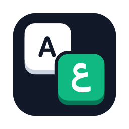

# KeySwap

Typed in the wrong language? KeySwap fixes it **by itself when you pause typing**, or when you select the text and **double-tap Shift**.

| You typed | You meant | After double-tap Shift |
|---|---|---|
| `lnpfh` (Mac) / `lvpfh` (Windows) | مرحبا | `مرحبا` |
| `اثممخ صخقمي` | hello world | `hello world` |

- **Fixes while you type:** pause for a moment and words typed with the wrong keyboard are replaced and the keyboard switches. It only acts when your computer's spell checker says the typed words are wrong and the other-keyboard words are right, and never in password fields.
- **Double-tap Shift** on selected text to fix anything yourself.
- Starts by itself when you turn on your computer.
- Works in every app: browsers, Word, WhatsApp, Slack, Notes, anything you can type in.
- Detects the direction automatically: Arabic → English or English → Arabic.
- Switches your keyboard to the right language afterwards, so you can keep typing (you can turn this off).
- Reads your real keyboard layouts from the system, so it matches your exact Arabic keyboard (Mac Arabic, Arabic – PC, Arabic 101, 102…).
- Keeps your clipboard: whatever you had copied is put back.
- Free and open source. Runs offline and sends nothing anywhere.

## Download

Get the latest version from the **Releases** page (what changed in each version: [CHANGELOG.md](CHANGELOG.md)):

- **Mac:** `KeySwap-mac.zip` (Apple Silicon and Intel, macOS 11 or later)
- **Windows:** `KeySwap.exe` (Windows 10 and 11)

## Install on Mac

1. Unzip and drag **KeySwap** into your **Applications** folder.
2. Open it. macOS will say it can't verify the developer, because the app isn't sold through Apple. Click **Done**, then open **System Settings → Privacy & Security**, scroll down, and click **Open Anyway** next to KeySwap.
3. When asked, allow **Accessibility** access (System Settings → Privacy & Security → Accessibility → turn on KeySwap). KeySwap needs it to copy and replace the selected text.
4. The `A⇄ع` icon appears in the menu bar. KeySwap now opens by itself when you log in (turn off **Open at Login** in its menu if you don't want that).

**Updating on Mac:** after installing a new version, open System Settings → Privacy & Security → Accessibility, remove KeySwap with **–** and add it again with **+**. macOS treats each new version of a free (unsigned) app as a new app.

## Install on Windows

1. Download `KeySwap.exe` and double-click it.
2. Windows SmartScreen may say "Windows protected your PC", because the app isn't signed with a paid certificate. Click **More info → Run anyway**.
3. The KeySwap icon appears in the system tray (near the clock; it may be under the `^` arrow). KeySwap now starts by itself with Windows (right-click the icon and turn off **Start with Windows** if you don't want that).
4. Fixing while typing uses the spell checker built into Windows. If the menu says Arabic spell checking is missing: Settings → Time & language → Language & region → `…` next to Arabic → Language options → install **Basic typing**.

## Use

- **Just type.** If you typed with the wrong keyboard, pause for a moment: KeySwap replaces the words and switches the keyboard.
- **Or fix it yourself:** select the text (Cmd+A / Ctrl+A for everything) and press **Shift** twice, quickly.

To undo, press Cmd+Z / Ctrl+Z as usual. Turn off **Fix While Typing** in the menu if you only want the Shift shortcut.

You need both an Arabic and an English keyboard added on your computer:
**Mac:** System Settings → Keyboard → Text Input → Edit.
**Windows:** Settings → Time & language → Language & region.

## Good to know

- Double-tapping Shift only counts when you press nothing else in between, so typing capital letters never triggers it.
- On Windows, KeySwap can't fix text in programs running as administrator unless KeySwap also runs as administrator.
- If nothing is selected, you'll hear a beep and nothing changes. (A few code editors copy the whole line when nothing is selected; select the text first.)
- English chat shortcuts and names stay English even when they look like Arabic on the other keyboard: lol, brb, idk, tmr, asap, wanna, whatsapp… Words in capitals (OK, ASAP) stay English too. Inside an Arabic sentence typed on the wrong keyboard, they're fixed with the rest of it.
- On the Windows Arabic keyboard, B types `لا`, the same as G then H. KeySwap picks `b` unless `gh` spells a common English word (light, through, enough…).

---

## بالعربي

كتبت بلغة غلط؟ KeySwap يصلّحها **لوحده لما توقف كتابة لحظة**، أو حدّد النص واضغط **Shift مرتين بسرعة**. وبيشتغل لوحده أول ما تفتح الجهاز.

**على الماك:** فك الضغط عن `KeySwap-mac.zip` وانقل KeySwap لمجلد Applications. افتحه، ولو ظهرت رسالة إن الماك مش قادر يتحقق من المطوّر، روح **System Settings ← Privacy & Security** واضغط **Open Anyway**. بعدها فعّل صلاحية **Accessibility** لـ KeySwap.

**على الويندوز:** شغّل `KeySwap.exe`. لو ظهرت رسالة "Windows protected your PC" اضغط **More info ← Run anyway**. هتلاقي الأيقونة جنب الساعة.

**الاستخدام:** حدّد النص (Cmd+A أو Ctrl+A) واضغط Shift مرتين. KeySwap يعرف لوحده إذا كان النص عربي أو إنجليزي، ويغيّر الكيبورد للغة الصح بعدها. للتراجع: Cmd+Z أو Ctrl+Z.

الاختصارات الإنجليزي زي lol و brb و tmr، والكلام المكتوب كابيتال زي OK، بتفضل إنجليزي زي ما هي.

---

## Build it yourself

- **Mac:** `./mac/build.sh` (needs Xcode Command Line Tools). Runs the tests, then makes `mac/build/KeySwap-mac.zip`. `./mac/build.sh install` also puts it in Applications and opens it.
- **Word lists:** the everyday words used to judge wrong-keyboard text are in `shared/common-words-*.txt`, and English chat shortcuts that are never converted (lol, brb, tmr…) are in `shared/english-shortcuts.txt`. After editing them, run `python3 shared/generate-word-lists.py`.
- **Windows:** double-click `windows\build.bat`. It uses the C# compiler built into Windows, so there's nothing to install. Runs the tests, then makes `windows\build\KeySwap.exe`.
- **Automatic:** every push to GitHub builds and tests both. Pushing a tag like `v1.0.0` publishes a release with both downloads.
